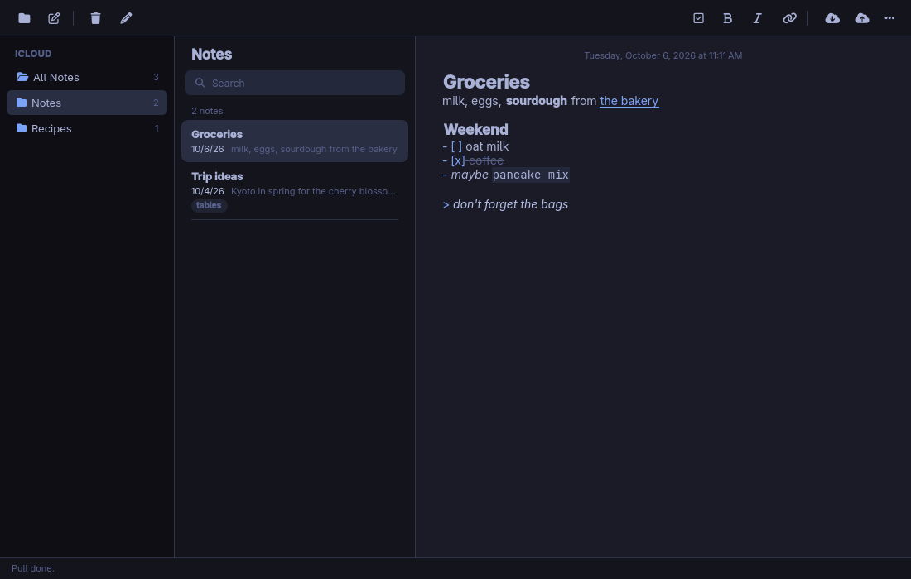
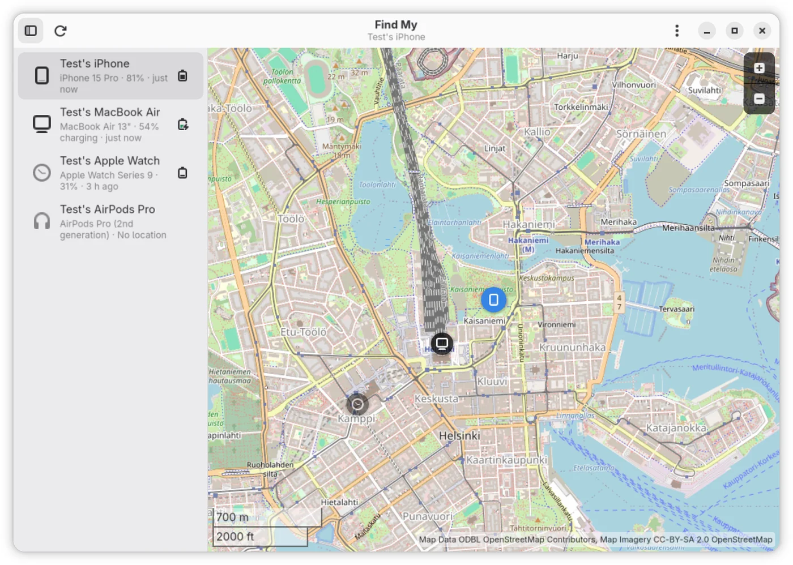
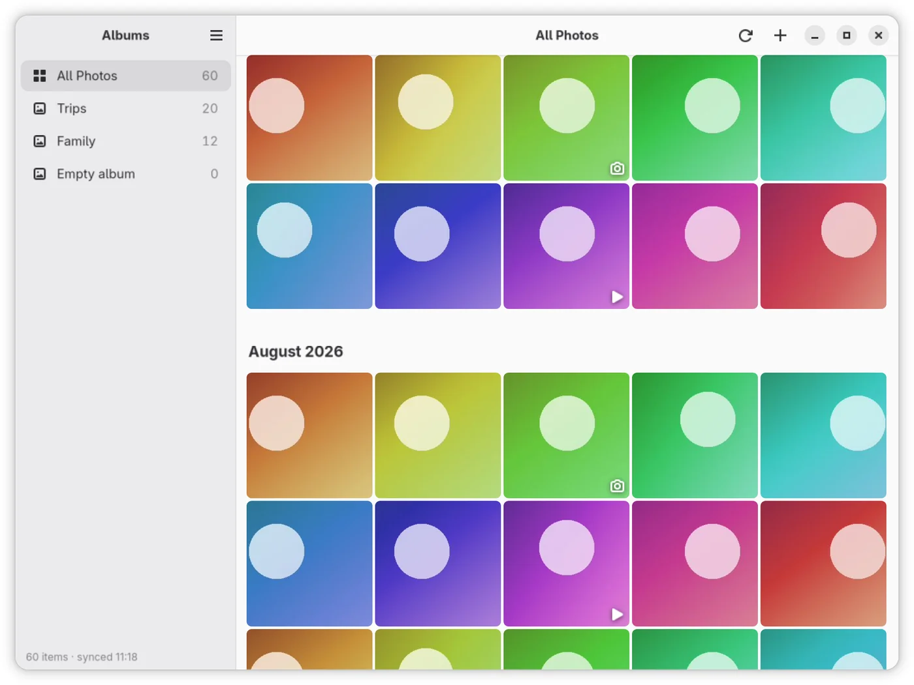

# icloud-for-omarchy

iCloud apps for [Omarchy](https://omarchy.org) (and any Arch Linux), sharing
one Apple sign-in, published as one signed pacman repository.

- **Notes**: your Apple Notes as a folder of Markdown files, synced both
  ways. Edit, rename, move or delete them in the app, in Neovim or Obsidian,
  or with `mv` and `rm`, and iCloud follows.
- **Photos**: browse, download, upload and delete your iCloud Photos.
- **Find My**: your devices on a map, with play sound, Lost Mode and a
  location trail.
- **Reminders**: your lists and reminders, completed with a click, and a
  desktop notification when one falls due, window open or not.
- **Contacts**: search your address book, copy a number or start an email
  in a click, add and edit contacts, and export them as vCards.
- Every window action also works from the terminal, with `--json` output
  for scripts and AI agents.

```bash
curl -fsSL https://github.com/ferdousbhai/icloud-for-omarchy/releases/latest/download/install.sh | sudo bash
```





<sub>Screenshots use demo data.</sub>

| Directory | Package | What it is |
|---|---|---|
| [notes/](notes/README.md), [notes-sync/](notes-sync/README.md) | `icloud-notes` | Apple Notes as a Qt/QML app and the `icloud-notes` command, synced with iCloud by its engine, icloud-notes-sync (notes-sync/, in Rust, originally derived from icloud-md), which the package installs off PATH. |
| [photos/](photos/README.md) | `icloud-photos` | iCloud Photos in GTK4/libadwaita: browse, download, upload and delete. |
| [findmy/](findmy/README.md) | `icloud-findmy` | Find My devices in GTK4/libadwaita: locate, play a sound, Lost Mode, history trail. |
| [reminders/](reminders/README.md) | `icloud-reminders` | iCloud Reminders in GTK4/libadwaita, and a systemd timer that notifies through Omarchy's notifications when a reminder falls due. |
| [contacts/](contacts/README.md) | `icloud-contacts` | iCloud Contacts in GTK4/libadwaita: search, add, edit, delete, vCard export. |
| [session/](session/README.md), [sessiond/](sessiond/) | `icloud-session` | The shared sign-in: a D-Bus daemon, a sign-in window and a CLI (sessiond/), plus the Rust client crate every app links (session/). |

The shared sign-in's design (the daemon, its D-Bus interface, the session
files) is in [session/README.md](session/README.md#design).

## Calendar, Mail and the rest of iCloud

Two more iCloud apps live in their own repositories, because they also
show other accounts in the same window. Both use this project's
icloud-session sign-in, so you don't sign in again:

- **iCloud Calendar**: [Cloud Calendar](https://github.com/ferdousbhai/cloud-calendar)
  (`cloud-calendar account add icloud`) shows your iCloud, Google and HEY
  calendars together, with event notifications.
- **iCloud Mail**: [Cloudmail](https://github.com/ferdousbhai/cloud-mail)
  (`cloudmail account add icloud`) reads, sends and searches iCloud Mail
  next to your own domains' mail, HEY and Gmail.

Messages, Phone and Maps are not covered. iMessage and phone calls need an
Apple device: iCloud has no web service for them. Apple Maps' saved places
aren't available from iCloud on the web either.

## Command line and agents

Everything the windows do can be done from a terminal, or by an AI agent:
`icloud-notes`, `icloud-photos`, `icloud-findmy`, `icloud-reminders` and
`icloud-contacts` take commands (`icloud-notes list`, `icloud-photos
download`, `icloud-findmy locate`, `icloud-reminders add`, `icloud-contacts
show`, ...)
and run them without a window, and `icloud-session` owns the sign-in. They
share `--json` output, one JSON error shape and one table of exit codes.

- [docs/AGENTS.md](docs/AGENTS.md): the reference to give an agent (auth,
  commands with example JSON, safety rules, recipes).
- [docs/skills/icloud/SKILL.md](docs/skills/icloud/SKILL.md): the same as a
  Claude Code skill; copy `docs/skills/icloud` into `~/.claude/skills/`.
- [docs/CLI.md](docs/CLI.md): every GUI feature mapped to its command, the
  exit and error codes, the JSON shapes.

Signing in is the one thing a person must do: Apple's page (password, 2FA)
opens in a window from `icloud-session sign-in`.

## Is this safe?

- **You sign in on Apple's own page**, password and two-factor code
  included, in a window opened by `icloud-session sign-in`. The apps never
  see your password.
- **What's kept** is the session cookies, in your system keyring (the
  Secret Service, e.g. GNOME Keyring). Only who is signed in and when the
  session was last checked are in a file,
  `~/.local/state/icloud-session/account.json`, readable only by you.
- **Your password is stored only if you choose to**, for Find My, which asks
  for it again from time to time: `icloud-session set-password` puts it in
  your system keyring (the Secret Service, e.g. GNOME Keyring), and
  `icloud-session forget-password` removes it.
- **The apps talk only to Apple**, plus OpenStreetMap for Find My's map
  tiles.
- **Notes and Reminders deletes are recoverable**: a note or reminder you
  delete goes to Recently Deleted in iCloud (about 30 days).
- **Contacts deletes are not**: iCloud has no Recently Deleted for
  contacts, so the app and `icloud-contacts delete` ask first. Only
  icloud.com's Data Recovery (Restore Contacts, a whole earlier version of
  your address book) brings one back.
- **It's all open source**, and the packages are signed with a key whose
  fingerprint is pinned in [install.sh](install.sh).

## Install

```bash
curl -fsSL https://github.com/ferdousbhai/icloud-for-omarchy/releases/latest/download/install.sh | sudo bash
```

installs all five apps (icloud-notes, icloud-photos, icloud-findmy,
icloud-reminders, icloud-contacts), which pull in icloud-session. To install only some, name them:

```bash
curl -fsSL .../install.sh | sudo bash -s -- icloud-photos icloud-findmy
```

The script ([install.sh](install.sh)) trusts the package-signing key (after
checking it against the fingerprint pinned in the script), adds the signed
`[icloud-for-omarchy]` repository on x86_64, or `[icloud-for-omarchy-aarch64]`
on aarch64, with the matching `/etc/pacman.d/<repository>.conf`
with an `Include` line in `/etc/pacman.conf`, installs an Omarchy
`pre-refresh-pacman` hook that restores the repository after
`omarchy refresh pacman`, and installs the packages in one `pacman -Syu`.
Re-running it is safe. Updates then arrive with `omarchy update`.

In the app launcher they are Notes, Photos, Find My, Reminders and
Contacts; searching "iCloud" finds them all. Photos saves originals straight into
`~/Pictures/<year>/<month>/`; after updating from a version that used
`~/Pictures/icloud-photos/`, its first start moves that folder's contents
up into `~/Pictures/` ([details](photos/README.md#your-files)).

### Install by hand

Rather not pipe a script into `sudo bash`? These are the same steps, one
at a time:

```bash
# 1. Download the package-signing key and check its fingerprint is
#    52130299581DAD685226900CA89CA1A6A1E74251
# These manual steps use the x86_64 repository. On ARM, use the installer above
# or replace icloud-for-omarchy with icloud-for-omarchy-aarch64 in repository/key names.
curl -fsSLO https://github.com/ferdousbhai/icloud-for-omarchy/releases/latest/download/icloud-for-omarchy-signing-key.asc
gpg --show-keys icloud-for-omarchy-signing-key.asc

# 2. Let pacman trust it
sudo pacman-key --add icloud-for-omarchy-signing-key.asc
sudo pacman-key --lsign-key 52130299581DAD685226900CA89CA1A6A1E74251

# 3. Add the signed repository
printf '[icloud-for-omarchy]\nSigLevel = Required DatabaseRequired\nServer = https://github.com/ferdousbhai/icloud-for-omarchy/releases/latest/download\n' \
  | sudo tee /etc/pacman.d/icloud-for-omarchy.conf
echo 'Include = /etc/pacman.d/icloud-for-omarchy.conf' | sudo tee -a /etc/pacman.conf

# 4. Install (on Omarchy: sudo pacman -Sy && omarchy-pkg-add icloud-notes icloud-photos icloud-findmy icloud-reminders)
sudo pacman -Syu icloud-notes icloud-photos icloud-findmy icloud-reminders
```

On Omarchy, `omarchy refresh pacman` rewrites `/etc/pacman.conf`; the
script installs a hook that adds the `Include` line back, so by hand you
would re-add it after a refresh.

On ARM, rerunning the installer removes the incompatible x86_64 repository
include, config and refresh hook before synchronizing the ARM repository.
Unsupported architectures stop before changing repository configuration.

Machines set up from earlier Notes releases, which had a repository of
their own (`[icloud-notes]`), are migrated: once `[icloud-for-omarchy]` is
added, the script removes `/etc/pacman.d/icloud-notes.conf`, its `Include`
line and its Omarchy hook.
The icloud-notes-sync package of earlier releases needs nothing from the
script: icloud-notes now carries the engine and `replaces` it, so the next
`omarchy update` swaps it out.

Every release also carries one installer per app, `install-notes.sh`,
`install-photos.sh`, `install-findmy.sh` and `install-reminders.sh`: install.sh with its default
set to that one app, generated by `bin/make-installers`. The website (not
in this repository) redirects its one-liners to these assets:
`https://ferdousbhai.com/icloud/install.sh` to `install.sh`, and
`https://ferdousbhai.com/icloud-<app>/install.sh` to that app's installer,
e.g. `.../releases/latest/download/install-photos.sh`, so
`curl ... | sudo bash` keeps installing just that app. The apps' page is
<https://ferdousbhai.com/icloud>.

To uninstall: `omarchy pkg drop <packages>`, then remove
`/etc/pacman.d/icloud-for-omarchy.conf`, its `Include` line in
`/etc/pacman.conf`, and
`~/.config/omarchy/hooks/pre-refresh-pacman.d/icloud-for-omarchy`.

## Layout

```
Cargo.toml, Cargo.lock   one Cargo workspace: session, sessiond, notes-sync, photos, findmy, reminders, contacts
session/  sessiond/      icloud-session: client crate / daemon, sign-in window, CLI
notes/                   icloud-notes (qmake project, QML, tests, its own bin/build and bin/test)
notes-sync/              icloud-notes-sync, the sync engine the icloud-notes package ships
photos/  findmy/         icloud-photos, icloud-findmy
reminders/               icloud-reminders (its systemd timer in reminders/data/)
contacts/                icloud-contacts
packaging/PKGBUILD        one split recipe builds all six packages
install.sh               the one installer (per-app copies are generated at release)
bin/                     build, test, release, verify-release, make-installers; dev-install/dev-uninstall for the daemon
tests/                   the add_signed_repo hash pin; install_test.sh, the installers against stubbed pacman
docs/                    the command-line reference (CLI.md, AGENTS.md, skills/)
```

Each directory kept its history: the five former repositories
(ferdousbhai/icloud-session, icloud-notes-sync, icloud-photos, icloud-findmy
and icloud-notes) were imported with `git filter-repo` into their
subdirectories and merged, so `git log --follow` on a file reaches back past
the move. icloud-notes' release tags `v0.1.0`...`v0.3.8` are here as
`notes-v0.1.0`...`notes-v0.3.8`.

## Development

Needs `rust`, `sqlite`, `gtk4`, `libadwaita`, `libshumate` (findmy) and
`webkitgtk-6.0` (the sign-in window) for the Rust crates, and `qt6-base`,
`qt6-declarative` and `make` for Notes. The apps talk to the icloud-session
daemon over D-Bus; for development without the package, `bin/dev-install`
puts a release build of it in `~/.local/bin` with a user D-Bus activation
file (`bin/dev-uninstall` undoes it).

```bash
bin/build                       # every package; or name some: bin/build icloud-photos
bin/test                        # rustfmt, clippy, all Rust tests, notes/bin/test, the installer checks
tests/install_test.sh           # the installers alone: stubbed pacman, scratch /etc in a user namespace
cargo test -p icloud-findmy     # one crate
notes/bin/test                  # the Qt app's tests alone (they run on a private D-Bus)
```

Rust binaries land in `target/release/`, Notes in `notes/build/`. Each app
can also run against a local fake of Apple's servers; its README says how.

notes-sync's recorded scenarios and golden corpora run with `cargo test`;
`ICLOUD_NOTES_SYNC_REGEN=1 cargo test -p icloud-notes-sync` re-records them
from the current code (see notes-sync/README.md).

## Releasing

Releases are cut from a checkout with the package-signing key in its
keyring. Native CI builds unsigned packages; signing stays on your machine:

```bash
bin/release 0.8.1
```

One suite version in `[workspace.package]` of `Cargo.toml` is inherited by
all Rust crates and the six packages. Releases use `v<version>` tags;
older per-app tags remain historical. Development packages add
`.r<count>.<commit>` to the suite version. The first suite release must be
newer than the current 0.8.0 baseline so existing installations upgrade.

`bin/release` updates that one version and the lockfile, runs `bin/test`,
commits and tags, then dispatches native x86_64 and ARM CI at that commit.
One split `packaging/PKGBUILD` builds and tests the workspace once and emits
all six independently installable packages. Before signing,
`bin/collect-packages` checks the complete package set, source commit,
architectures, filenames and exact suite version. Failed builds publish
nothing and leave the candidate tag for inspection.

Signing stays on the release machine. It signs each package and the
`[icloud-for-omarchy]` (x86_64) and `[icloud-for-omarchy-aarch64]` databases
with the same pinned key. Output goes to `dist/release/`, separately from
build artifacts and download caches.

After publication, CI alone runs `bin/verify-release <tag>` on both
architectures. It compares all six published installers with the tagged
source, installs the complete suite once in a fresh Arch root, then checks
every installed version. Per-app installer behavior is covered by
`tests/install_test.sh`. Failures leave releases available for diagnosis;
retry the workflow or run `bin/verify-release v<version>` on a matching
native host with `sudo` and `arch-install-scripts`.

The client library's crates.io publication is separate: from a verified
release checkout, run `cargo publish --locked -p icloud-session` when needed.
It is never an automatic side effect of publishing the app suite.

GitHub's Ubuntu runners use `bin/arch-run` to bootstrap a disposable native
Arch chroot, without Docker. The host needs `arch-install-scripts`, `curl`,
`tar` and `zstd`. On Arch/Omarchy, install the build dependencies listed
above plus `base-devel`, `cargo` and `git`, then run
`bin/build-packages "$(uname -m)"` as a regular user. It builds committed
HEAD in scratch space and writes packages to `dist/<arch>/`.
Cargo uses available cores by default; `CARGO_BUILD_JOBS` overrides this.
CI caches downloads in `dist/cargo-<arch>/` by architecture and `Cargo.lock`;
compiled artifacts are reused within a run only.

The installer retains its pinned `add_signed_repo` hash as a regression
check. Ghost no longer carries this function; iCloud installer changes
are tested here.

### The signing key

One key signs these packages and those of Cloudmail, Cloud Calendar
and Omacloud ("Omacloud (package signing)",
52130299581DAD685226900CA89CA1A6A1E74251); its fingerprint is pinned in
each installer and it lives in the releasing machine's keyring, protected by
a passphrase, with a backup kept off the machine.

Releases before October 2026 were signed with
35C47A06567940B6796B4D0F9B3C7BDF85268B31, which is no longer used. A
machine that installed from those releases trusts only the old key, so its
next update fails with "unknown trust"; running the one-liner again trusts
the current key, and it is idempotent.

## License

MIT, see [LICENSE](LICENSE). Third-party credits (icloud-md, node-diff3,
the mdast/micromark utilities, yaml, pyicloud) are in [NOTICE](NOTICE).
